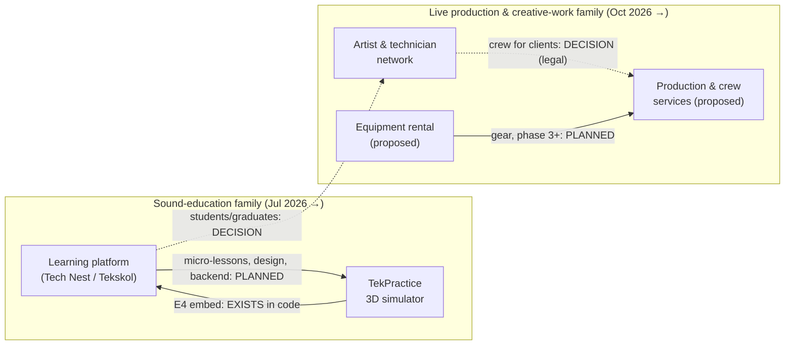

# Tekonest — service and relationship map

> Written after the individual [service visions](services/). Links L7, L8, L10, L13 and L14 concerned the event idea and moved to the [Rebels × Tekonest](../projects/rebels-x-tekonest/README.md) project; their numbers are not reused. Each link is marked with how certain it is. Linking two services here does **not** mean they must be connected.

**Link states**

| State | Meaning |
| --- | --- |
| **EXISTS** | Present today in code or in a signed or done fact |
| **PLANNED** | Written into a plan, spec or code seam, but not working yet |
| **POSSIBLE** | Not in any plan; an inference from the evidence |
| **DECISION** | Needs a founder decision, or has a conflict to resolve first |

## 1. Links between services

| # | Link | What flows | State | Evidence |
| --- | --- | --- | --- | --- |
| L1 | TekPractice → learning platform (E4 course) | The simulator is embedded on the E4 course page (iframe to `sim.teknest.fr`, with a "bientôt" fallback) | **EXISTS** in code; live not verified | LP C, `SimulatorEmbed.tsx` |
| L2 | Learning platform → TekPractice (Learn mode) | Micro-lessons from the theory site ("Tekskol") inside the simulator | **PLANNED**, not started | LT-14, TP-40 |
| L3 | Learning platform ↔ TekPractice (design system) | "UN seul design system, partagé site+jeu" | **PLANNED**; conflicts with the site's current dark design | LT-28, LP-32, LT conflict 9 |
| L4 | Learning platform ↔ TekPractice (accounts, progress, certificates) | A common backend; simulator progress feeding the certificates | **PLANNED** (seam documented; both still browser-only) | LT-37, LT-16 |
| L5 | Learning platform ↔ TekPractice (domain) | `teknest.fr` was used for the site and for the simulator at different dates | **DECISION** | LT-05, LT-06, LP-30 |
| L6 | Learning platform ↔ TekPractice (AI) | Site tutor (Claude/Gemini) and simulator coach (Anthropic, user key) are built separately; no link today | **POSSIBLE** (unifying them) | LP-23, TP-32 |
| L9 | Network → production & crew services | Members working for other organisers | **DECISION**: needs a lawful model (L8241-1) | EV-76 |
| L11 | Equipment rental → production | Owned gear used and rented out | **PLANNED** for phase 3+ in the plan; nothing owned | Rebels × Tekonest register §C |
| L12 | Learning products → network | BTS students and graduates join the network; internship finder; "community + mentors" | **DECISION**: in no plan; touches minors, pay and consent | TP-11, LP-35 |

## 2. Shared resources across the umbrella

| Resource | Shared how | State |
| --- | --- | --- |
| **People** | The founder is in every service. Ahmad and Gabriel appear only in the Rebels × Tekonest docs | **EXISTS** (EV-15–EV-21) |
| **Skills** | Sound and audiovisual craft underpins all services | **EXISTS** [Inf] |
| **Founder time and personal work limits** | The founder's personal work-status limits apply to any paid role he takes in any service (details in [`projects/rebels-x-tekonest/docs/01`](../projects/rebels-x-tekonest/docs/01-legal-structure-guide.md); depend on his situation; not verified; not legal advice) | **DECISION** constraint on all services |
| **Equipment** | Rented or borrowed for events. Simulator gear is virtual only | **POSSIBLE** (nothing shared today) |
| **Technology** | Learning platform and TekPractice both deploy on Vercel (possibly different accounts) and used `teknest.fr` at different dates; similar AI seams. The event strand has none | **EXISTS** in parallel, not shared; domain is a **DECISION** (L5) |
| **Audiences and marketing** | Separate for now | **POSSIBLE** |
| **Revenue** | No service earns money yet | **DECISION**: whether one service may fund another |
| **Brand identity** | "Tek" family names; two design directions (dark site, white game) | **DECISION** (see [umbrella §6](01-umbrella-vision.md#6-brand-architecture-options-not-yet-decided)) |

## 3. Conflicts and tensions between services

1. **Different audiences, different tones.** An exam-prep tool for possible minors and a paid-crew network share one name. That needs a brand-architecture decision **[Inf]**.
2. **Founder time.** Two families are under way in parallel: software in July, the network and partner projects in October. Both depend on the same person and his personal work limits **[Inf]**.
3. **Pay model.** The network's "fairly paid" promise must also hold for any student link (L12). Unpaid student "experience" is not a workaround **[R]** (EV-55).
4. **Domain and name.** `teknest.fr` was claimed by both learning products at different times. "Tekonest" is not yet used in any product **[I]**.
5. **Design.** The theory site is dark and studio-grade; the game is white and calm **[I]**.

## 4. A plausible sequence for connecting services

> **[Rec] Not an approved roadmap.** It is one order, suggested by Claude, that respects the dependencies above.

1. **Foundations**
   - choose the brand architecture and names (Q1);
   - confirm ownership of the learning code and ideas (Q3);
   - choose a legal-structure path, since it gates every paid activity (Q4).
2. **Stabilise what exists, without new features**
   - one known-good public TekPractice build;
   - confirm the learning platform's live state.
   - This finishes L1.
3. **First network projects**
   - pay the crew;
   - start the network list from people who actually worked on a real project.
4. **Join the education family properly**
   - shared design, accounts and Learn mode (L2–L4).
5. **Bridge the families only if the founder wants it**
   - an opt-in route from students and graduates to the network (L12);
   - event rigs as TekPractice levels (L13).
6. **Production & crew services, then equipment rental**
   - only after a lawful model, a legal entity and evidence of demand (L9–L11).
