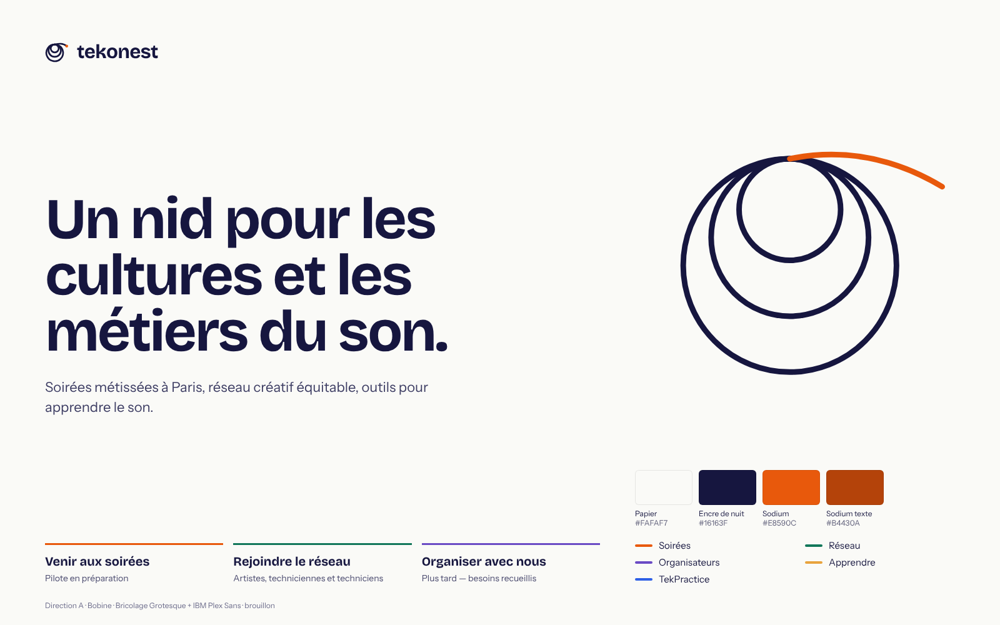
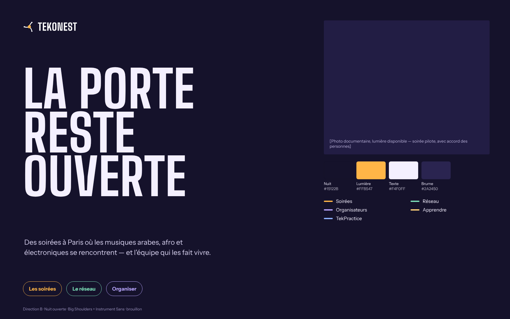
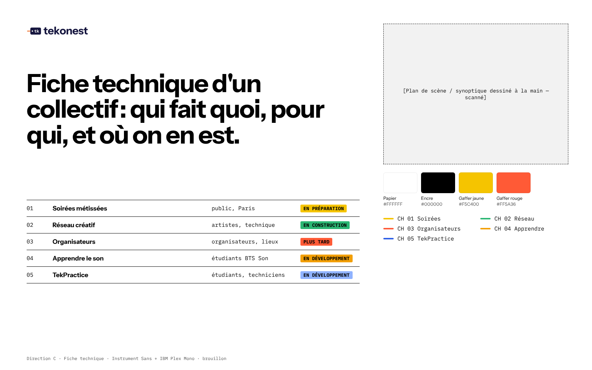

# Phase 2 — Three art directions and a recommendation

> Agents: **tekcreativedirector** (ideas and recommendation) and **tekbranddesigner** (identity). All three are **drafts pending founder review**.
> Boards: `boards/*.png`, rendered from `boards/*.html`. Research behind the choices: [`../research/`](../research/).

Common constraints, from the brief and the research:
- **No generic gradients, neon or stock crowds.** Diversity is shown through real people, real programming and named genres, never "oriental" ornament.
- **One master brand.** Branches use plain names, and TekPractice is shown "by Tekonest". This follows the Aaker brand-relationship spectrum: a separate brand only when necessary.
- **Route by task, not by audience type.** Nielsen Norman Group warns that splitting navigation by audience degrades usability, so the routes are three action doors.
- **The two existing products keep their own look**: the dark studio-grade learning site and the white-gallery TekPractice. Each direction must sit *above* them, not repaint them.

---

## A. Bobine (recommended)

| | |
| --- | --- |
| **Central idea** | Every sound technician learns to coil a cable over-under; it's the first ritual of the craft. A coil holds many strands in one calm, round form. That is also what a nest is, and what Tekonest wants to be: different strands (cultures, people, skills) held together, with one strand always leaving towards the next project. |
| **Why it fits** | It comes from the founder's own craft rather than from a genre cliché. It speaks to all five branches: the nights, the network, the crews, learning and the simulator. And it gives a real meaning to the name *nest*. |
| **Typography** | **Bricolage Grotesque** (OFL, variable `opsz`/`wdth`/`wght`) for display: warm, slightly irregular grotesque details at large sizes, tight tracking (−0.035em). **IBM Plex Sans** (OFL) for text, because it pairs with **IBM Plex Sans Arabic** for real Arabic names and titles when the programme needs them. Headlines are set large, flush left, in sentence case, with no accent word. |
| **Colours** | Papier `#FAFAF7` (ground) · Encre de nuit `#16163F` (text and logo; night without black) · Sodium `#E8590C` (the Paris street-lamp: one warm signal for the strand leaving the coil, focus and key actions; `#B4430A` when used as text). **Cable colours** mark branches only as thin lines, tags and focus rings: Soirées sodium, Réseau `#12775A`, Organisateurs `#6A4BC4`, Apprendre `#E8A33D` (the learning site's amber), TekPractice `#2E5FE6` (TekPractice's own accent). Technicians already colour-code cables, so this borrows a real habit. |
| **Layout / grid** | 12 columns, max 1200 px, generous left-aligned text. The coil sits as a large line drawing on the right of the hero. Thin "cable" rules (3 px, in the branch colour) sit on top of each branch block. |
| **Photography / illustration** | Documentary portraits and working moments of the real people (artists, crews, audiences), with written consent and credits (*droit à l'image*). Until a pilot happens, honest empty frames say "Photo de la soirée pilote — à venir". The only illustration is line drawing: the coil and signal-flow diagrams. |
| **Icons and motion** | 2 px round-cap line icons (cable-like). **One** orchestrated moment: the coil draws itself once on page load (≈1.2 s). Everything else moves only in answer to the visitor. `prefers-reduced-motion` gives a static coil. |
| **Logo** | **Bobine**: a coil hanging from one point, the loops sharing the hook, with a sodium plug at the end of the strand. In the wordmark the "o" becomes a small coil. |
| **Sample hero** | « Un nid pour les cultures et les métiers du son. », then three doors: *Venir aux soirées / Rejoindre le réseau / Organiser avec nous*. |
| **Branch adaptation** | Same paper, ink and type everywhere. Each branch adds its cable colour to rules, tags and focus. Soirées may add documentary photography; Réseau has portraits with credits. **Apprendre** keeps its dark studio skin inside the app and shows "Apprendre · par Tekonest" in its header. **TekPractice** keeps its white gallery and blue accent, with the same "par Tekonest" endorsement. |

## B. Nuit ouverte

| | |
| --- | --- |
| **Central idea** | Paris at 23:00: a door left open, warm light spilling onto the pavement. Hospitality first, so the nights are the front door of the brand. |
| **Typography** | **Big Shoulders** Bold (OFL), condensed and set in poster capitals, with **Instrument Sans** (OFL) for text. |
| **Colours** | Nuit `#15122B` · Lumière `#FFB547` · Texte `#F4F0FF` · Brume `#2A2450`. Branch colours are light pastels on the dark ground. |
| **Layout** | Full-bleed poster sections, huge type, one photo per screen. |
| **Imagery** | Available-light documentary photography with grain, taken at the nights themselves. |
| **Icons and motion** | Bold filled pictograms; a slow light "sweep" when a section comes into view. |
| **Logo** | **Jonction**: three strands meeting at one warm node (people meeting at a crossroads), with a condensed capital wordmark. |
| **Branch adaptation** | Works well for Soirées and Réseau. It fits poorly with Apprendre and TekPractice, whose study-tool audiences need calm, and it reads as "nightclub" to organisers and parents of BTS students. |

## C. Fiche technique

| | |
| --- | --- |
| **Central idea** | Every show starts with a *fiche technique* and a patch list. Tekonest presents itself as an honest tech sheet: who does what, for whom, and where it stands. |
| **Typography** | **Instrument Sans** Bold for display and **IBM Plex Mono** for patch-list data (justified here because the content really is tabular). |
| **Colours** | White, black, gaffer-tape yellow `#F5C400` and gaffer red `#FF5A36` for status tags. |
| **Layout** | A table-first grid; channel numbers are used only where they are real data. |
| **Imagery** | Hand-drawn stage plots and scanned signal-flow sheets; real photographs used sparingly. |
| **Icons and motion** | Labels like strips of gaffer tape; a minimal "tape strip" reveal. |
| **Logo** | **Étiquette**: the cable tag every tech writes on, with a tape strand through the hole and "tk" lettered on it. |
| **Branch adaptation** | Superb for Réseau, Organisateurs, Apprendre and TekPractice. Cold for night-goers, and the cultural warmth has to come entirely from photography. |

---

## Comparison (1 = weak, 5 = strong; judgement, not measurement)

| Criterion | A. Bobine | B. Nuit ouverte | C. Fiche technique |
| --- | --- | --- | --- |
| Clarity (5-second test) | 5 | 3 (beautiful, but says "nights" only) | 4 |
| Distinctiveness | 4 | 3 (nightlife poster codes are common) | 4 |
| Cultural openness | 4 | 4 | 2 |
| Accessibility (contrast, calm) | 5 | 4 (dark mode needs care) | 5 |
| Scalability across 5 branches | 5 | 2 | 4 |
| Bridges the dark learning site and white TekPractice | 5 (neutral paper, cable colours) | 2 | 4 |
| Ease of implementation | 5 (type + line drawing) | 3 (depends on strong photography) | 4 |

## Recommendation

**Direction A, Bobine**, carried into the prototype.

- **Why:** its idea comes from inside the craft (coiling a cable), it gives meaning to the name, it treats all five branches equally, and it bridges the two existing products without repainting them.
- **Trade-off 1:** it is calmer than B, so the night's energy must come from real photography and programming once the pilot happens. **B's warm photography rules can be borrowed for the Soirées branch.**
- **Trade-off 2:** C's honest status table is the clearest way to show "where we are". **It is reused as the status band on the home page.**

## Design philosophies (canvas-design)

**Bobine: "Tension douce".** Form is a held line. A single strand, wound with patience, makes a round and resting shape. The coil is calm because of the tension inside it, and that paradox governs the whole system: generous paper, one ink and one warm signal; type set large and close like a voice in a small room; colour arriving only as thin strands that say where something leads. Space is never empty decoration: it is the slack of the cable, the room before the next project. Every curve is drawn with the care of someone who has coiled ten thousand cables, and every margin is measured and re-measured until it disappears. The result must feel painstakingly made, quiet and exact.

**Nuit ouverte: "Lumière de seuil".** The threshold between street and room. Darkness is the material and light is the message, falling in wedges and bands, never in glows. Type stands tall and narrow like people in a doorway, and photographs are taken in the light that was actually there. Mastery shows in restraint: one source of light per composition, placed with intent.

**Fiche technique: "Inventaire".** Truth as a visual system. Lists, channels, labels and tape are kept honest, aligned and complete. Ornament is replaced by accuracy: a status tag carries more feeling than an illustration, because it can be trusted. Each table is set with a typesetter's patience, and each label is written as if a show depended on it.
