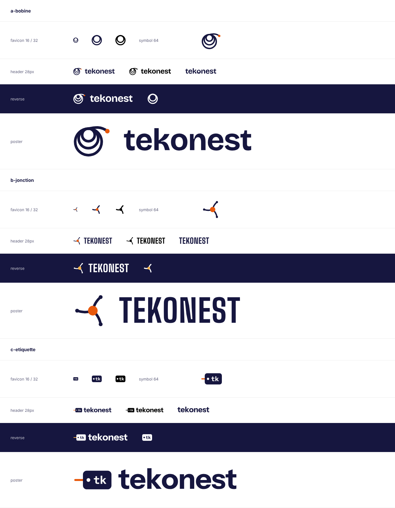

# Phase 3a — Logo concepts (drafts pending founder review)

> Agent: **tekbranddesigner**. Every file here is an editable SVG with its letters outlined, so no font is needed. They are generated by `gen_logos.py` from Bricolage Grotesque, Big Shoulders, Instrument Sans and IBM Plex Mono (all SIL OFL 1.1). No bitmap is used as a logo, and no existing mark was imitated.

Each concept folder contains `symbol`, `wordmark`, `lockup` (symbol + wordmark) and `favicon`, each in a colour version (`*.svg`), a black one-colour version (`*-mono.svg`) and a version for dark backgrounds (`*-reverse.svg`). `preview.html` is the test sheet that `preview.png` is rendered from.

## A. Bobine (recommended)

- **Idea.** A cable coil hanging from one hook: loops of three sizes share one point, and one strand leaves to a sodium-orange plug. It reads as a coil (the technician's craft), as a nest (*nest*), and as people held together. The strand leaving says "towards the next project".
- **Wordmark.** "tekonest" in lowercase Bricolage Grotesque Bold. The "o" is a small two-loop coil, so the symbol lives inside the name.
- **Favicon.** Two loops, no strand, with a thicker stroke so it stays legible at 16 px.
- **Minimum size.** Lockup 24 px high on screen and 20 mm in print. Symbol 16 px (use the favicon file below 24 px).
- **Clear space.** The height of the smallest loop on every side.
- **Revision note.** The first draft had the strand leaving diagonally, so the mark read as a search (magnifying-glass) icon. It was redrawn as a hanging coil. Lesson for later edits: never let the strand leave at the bottom right.

## B. Jonction

- **Idea.** Three strands, for three audiences, meet at one warm node, with a slight turning movement like a pinwheel. Condensed capitals (Big Shoulders) for a poster voice.
- **Minimum size.** Lockup 24 px high. The symbol becomes thin below 24 px, so the favicon uses a simplified version.
- **Clear space.** The diameter of the node.
- **Limit.** At small sizes it can read as a molecule, a peace sign or a "share" icon.

## C. Étiquette

- **Idea.** The cable tag every technician writes on, with a strand passing through the hole and "tk" lettered on it.
- **Minimum size.** Lockup 24 px high. Excellent at favicon size (a solid shape).
- **Clear space.** The height of the "tk" letters.
- **Limit.** Very "tech": it speaks less to night-goers.

## Branch naming (all concepts)

The brand architecture follows the master brand: descriptive branch names next to the Tekonest mark, with a single endorsed product.

| Branch | Name on the site | Lockup |
| --- | --- | --- |
| Network | Réseau | `tekonest` + « Réseau » |
| Organisers | Organiser (working label) | `tekonest` + « Organiser » |
| Learning platform | Apprendre (final product name **to decide**: Tech Nest / Tekskol / other) | product name + « par Tekonest » |
| Simulator | TekPractice | « TekPractice » + « par Tekonest » |

## Recommendation

**A. Bobine.** It is the only concept that carries the name's meaning, it holds up at 16 px, and it works on the white TekPractice studio, on the dark learning site and on paper. **Status: draft, pending founder review and a trademark search for "Tekonest" (not done).**
