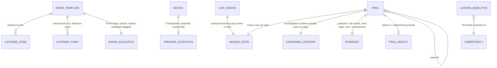

# TekPractice data model for rooms, speakers and "Essais" (proposal, revised after council)

**Status:** design proposal by tekinspi, 2026-10-24, revised after the expert council (`council/synthesis.md` §4 and §6b). Nothing here is implemented. It fits the existing files described in `tekpractice-current-state.md`.

**Naming:**
- The learner-facing word is **Essai**; the code name is **`Trial`**.
- **No new identifier contains "snapshot".** `RigSnapshot` is already the engine's graph view (ADR-0001), and Fohhn uses "snapshot" for two unrelated things.

**Invariants (non-negotiable, data architect, T NN1–7):**
1. An evaluated Trial is **write-once**. Only its name, note amendments and deletion are allowed afterwards.
2. Nothing stored is ever silently deleted or reset. Unreadable payloads are **quarantined**.
3. A **global byte budget** applies, and every storage write failure is shown to the student.
4. The fingerprint is **canonical, versioned and quantised**.
5. Content revisions are **generated by tools**, never bumped by hand.
6. The inputs an evaluation consumed are **embedded by value**.
7. `SavedRig` v2 lives under a **new key**.

## 1. Entity diagram



## 2. TypeScript interfaces

The proposed new module is `src/trials/`. It is pure TS and is not imported by `src/engine/`.

```ts
// ---- reused ----
// PortRef, ControlValue, LevelState, TeachingEvent   src/engine/types.ts / LevelRunner
// CameraPose                                         src/scene/CameraRig.ts
// SavedRig (v1)                                      src/ui/shelf.ts

type DeepReadonly<T> = { readonly [K in keyof T]: DeepReadonly<T[K]> };

// ---- provenance: per field, required ----
export type Provenance =
  | { kind: 'synthetic'; model: string; note_fr: string }
  | { kind: 'kb'; kbPath: string; sourceUrls: string[] }                  // TEK Brain record (sources inside)
  | { kind: 'manufacturer-spec'; url: string; accessed: string }
  | { kind: 'licensed-table'; licence: string; url: string; accessed: string };

export interface Sourced<T> { value: T; provenance: Provenance }

// ---- speaker acoustics: content/acoustics/speakers.json (a proposal file, reviewed by Oscar) ----
export interface SpeakerAcoustics {
  deviceId: string;
  kind: 'powered' | 'passive';
  maxSplContinuousDb: Sourced<number> | null;  // e.g. a published continuous max SPL at 1 m
  maxSplPeakDb?: Sourced<number> | null;
  sensitivity?: Sourced<{ db: number; ref: '1W/1m' | '2.83V/1m' }> | null; // PASSIVE ONLY
  coverageHDeg: Sourced<number> | null;        // nominal −6 dB
  coverageVDeg: Sourced<number> | null;
  directivity: { kind: 'cosine-power'; nH: number; nV: number; rearFloorDb: -20 }  // formula fixed in ADR-0011
             | { kind: 'omni' };
  contentHash: string;                          // generated by the tool, never hand-edited
}

// ---- room additions: content/rooms-acoustics/<id>.json (second output of tools/sync-rooms.ts) ----
export interface RoomAcoustics {
  roomId: string;
  geometryRev: string;                          // hash of dimensions + zones + openings (not lighting/colours)
  acousticsRev: string;                         // hash of RT60 + surfaces + points
  volumeM3: Sourced<number>;                    // derived; estimate flag via provenance
  surfaceM2: Sourced<number>;                   // needed by any statistical estimate
  rt60s: Sourced<{ min: number; max: number; bandNote?: string }> | 'not found';
  listenerPoints: ListenerPoint[];              // includes exactly one isReference point
  estimated: boolean;
}

export interface ListenerZone {
  id: string; kind: string;
  rect_m: [cx: number, cz: number, w: number, d: number];
  earHeightM: number;                           // seated 1.2 / standing 1.6; source to be cited in TEK Brain before use
  gridStepM: number;
}
export interface ListenerPoint { id: string; label_fr: string; position_m: [number, number, number]; isReference?: boolean }

// ---- live and frozen design ----
export interface Placement {
  instanceId: string; deviceId: string;
  position_m: [number, number, number];        // quantised to 1 mm when frozen
  yawDeg: number; pitchDeg: number;             // quantised to 0.1°
  mount?: 'floor' | 'stand' | 'flown' | 'desk';
}
export interface SpeakerSetting {
  instanceId: string;
  headroomDb: number;                           // ≤ 0: level below max continuous SPL (powered) or below max (passive)
  delayMs: number;                              // quantised to 0.01 ms
  polarity: 1 | -1;
}
export interface ComputeSettings {              // inside the fingerprint
  fidelity: 'a' | 'a+';                         // 'b' only after a new decision
  quantity: 'coverage' | 'arrival-time' | 'relative-direct-level';
  referencePointId: string;
  temperatureC: number;                         // for c
  assumedSpectrum?: 'pink';                     // required before any weighted value (not in phase 1–2)
}
export interface DisplaySettings {              // NOT in the fingerprint (switching is display only)
  colourRangeDb?: [number, number];
  overlay: boolean;
  view?: CameraPose;
}
export interface DesignState {
  roomId: string;
  rig: Pick<SavedRig, 'instances' | 'connections' | 'controls'>;
  placements: Placement[];
  speakers: SpeakerSetting[];
  listenerZoneIds: string[];
  studentPoints: ListenerPoint[];
  compute: ComputeSettings;
}

// ---- evidence (phase 1, no acoustics needed) ----
export interface Evidence {
  prediction: { text: string; writtenAt: string };   // writtenAt < frozenAt, enforced
  ruleResults: TeachingEvent[];                       // R1–R8 outcome at freeze time
  levelState: LevelState | null;                      // chainComplete, missing, violations…
  rulesRev: string;                                   // hash of the catalog rules used
  note: string;                                       // locked once a child exists
  noteAmendments: { text: string; at: string }[];     // append-only
  changedSinceParent: string[];                       // e.g. ['placement:spk-l','connection:+1']; >1 → "plusieurs changements"
}

// ---- consumed content: what the evaluation actually used, by value ----
export interface ConsumedContent {
  room: { geometryRev: string; acousticsRev: string; zones: ListenerZone[]; points: ListenerPoint[]; volumeM3?: number; surfaceM2?: number };
  speakers: Record<string, { contentHash: string; coverageHDeg?: number; coverageVDeg?: number; directivity: SpeakerAcoustics['directivity']; maxSplContinuousDb?: number }>;
  engineVersion: string;                              // guarded by golden fixtures in CI
}

export interface TrialResult {                        // phase 2+ only
  fidelity: 'a' | 'a+';
  points: { pointId: string; relDb?: number; arrivalMs?: number; inFootprint?: boolean }[];  // relDb whole dB vs reference
  footprintPct?: number;
  grid?: { zoneId: string; stepM: number; nx: number; nz: number; int16b64: string };       // relative dB × 10
  warnings: Array<'estimated-room' | 'synthetic-directivity' | 'overlap-not-modelled' | 'line-array-illustrative'>;
}

export type Trial = DeepReadonly<{
  formatVersion: 1;
  id: string;                    // 'tr_' + ulid
  name: string;                  // "Essai A"
  frozenAt: string;
  parentId: string | null;
  fingerprint: string;           // 'fp1:' + sha256(canonical(design + compute))
  design: DesignState;           // by value
  consumed: ConsumedContent;     // by value
  evidence: Evidence;
  result: TrialResult | null;    // null in phase 1
  levelId?: string; objectiveIds?: string[];         // 'O-…' ids
}>;

export interface LessonObjective {
  id: `O-${string}`; competencyId: string;           // must be a TEK Brain curriculum id
  metric: 'arrival-gap-ms' | 'arrival-order' | 'footprint-pct' | 'written-delay-error-ms' | 'most-exposed-point';
  target: number | string; tolerance?: number; pointIds?: string[];
  fidelityRequired: 'a' | 'a+';
}
```

## 3. By value vs by ID (revised)

| Data | How | Why |
|---|---|---|
| Placements, settings, wiring, controls, student points, compute settings | **By value**, quantised | Reproducible; a stable fingerprint |
| Evidence (prediction, rule results, level state, note) | **By value**, write-once (note: append-only amendments) | This is the learning evidence a teacher reads |
| Room zones, points, volume and surface; speaker numbers actually used | **By value** in `consumed`, plus `geometryRev`/`acousticsRev`/`contentHash` | An old Essai still shows what the student saw; the hashes detect content drift |
| Display settings (colour range, overlay, camera) | **Not fingerprinted** | Switching a view is not a new evaluation |
| Calculation code | `engineVersion` + golden fixtures in CI | A changed formula without a version bump fails CI |

## 4. Lifecycle

- **Live state.** `LiveDesign` autosaves under `audio-sim/live-design` (one per room). It survives the reload that a room change triggers. It is never a Trial.
- **Freeze ("Figer l'essai").**
  1. Check that the prediction exists.
  2. Build the canonical design.
  3. Compute `fp1`.
  4. If `fp1` **and** all refs equal the displayed Trial's, nothing happens; otherwise create the Trial.
  5. Run the rules and record the level state.
  6. In phase 2+, evaluate in a Worker.
  7. Append to the store: a **single write**.
- **Stale.** The live fingerprint ≠ the displayed Trial's fingerprint → "Résultat à refaire".
- **Content drift.** A hash in `consumed` ≠ the current content → "Salle ou fiche modifiée depuis cet essai". The result is kept, never recomputed silently.
- **Restore.** "Repartir de cet essai" sets the live state to a clone of `trial.design`. The next freeze becomes its child.
- **Recalculate with current data.** This creates a **new** Trial.
- **Delete.** Confirm, then a one-step undo toast.
- **Export.** `.essai.json` with `{ formatVersion, exportedAt, app: 'tekpractice', trials: Trial[] }`, labelled "déclaratif". It can be forged, so exam use needs ADR-0011.

## 5. Storage

- **Keys:**
  - `audio-sim/trials` → `{ version: 1, trials }`
  - `audio-sim/trials.quarantine`
  - `audio-sim/live-design`
  - `audio-sim/rigs.v2`
- **Budget:**
  - A global cap of about **1.5 MB / ~150 Trials**, to be **measured** (3 KB per Trial without a grid is an unmeasured estimate).
  - Grids are int16 base64, or recomputed on demand.
  - Progress data is never starved.
- **When storage is nearly full (⚠ C5):** an "Exporter puis archiver" prompt, with a hard stop only at the absolute budget. Every write failure is shown.
- **Load:**
  1. Run a strict zod parse.
  2. Re-verify each fingerprint.
  3. On failure → quarantine (read-only, exportable) plus a notice. **Never `removeItem`.**
- **`SavedRig` v2:**
  - Copy-migrated from `audio-sim/rigs` with `roomId: null`; v1 is left untouched.
  - A clobber test proves an old build can't overwrite v2.

## 6. Example (illustrative values, no real measurement)

```json
{
  "formatVersion": 1, "id": "tr_01JB7Z1K3Q8", "name": "Essai B – retard réglé",
  "frozenAt": "2026-10-24T10:12:00Z", "parentId": "tr_01JB7YZP0A1",
  "fingerprint": "fp1:9c1e…",
  "design": {
    "roomId": "auditorium-medium",
    "rig": { "instances": [{"instanceId":"spk-l","deviceId":"qsc-k12-2"},{"instanceId":"dly-l","deviceId":"qsc-k12-2"}], "connections": [], "controls": {} },
    "placements": [
      {"instanceId":"spk-l","deviceId":"qsc-k12-2","position_m":[-4.0,2.2,-9.0],"yawDeg":10,"pitchDeg":-8,"mount":"stand"},
      {"instanceId":"dly-l","deviceId":"qsc-k12-2","position_m":[-4.0,2.6,5.0],"yawDeg":0,"pitchDeg":-10,"mount":"stand"}
    ],
    "speakers": [{"instanceId":"dly-l","headroomDb":-6,"delayMs":43.5,"polarity":1}],
    "listenerZoneIds": ["salle"], "studentPoints": [],
    "compute": {"fidelity":"a","quantity":"arrival-time","referencePointId":"p3","temperatureC":20}
  },
  "consumed": { "room": {"geometryRev":"g-7f3a","acousticsRev":"a-11c2","zones":[],"points":[{"id":"p3","label_fr":"Fond de salle","position_m":[0,1.2,12],"isReference":true}]},
                "speakers": {"qsc-k12-2":{"contentHash":"s-02","coverageHDeg":75,"directivity":{"kind":"cosine-power","nH":3,"nV":3,"rearFloorDb":-20}}},
                "engineVersion": "evalA@0.1.0" },
  "evidence": {
    "prediction": {"text":"Δd ≈ 13,2 m → 38,5 ms ; +5 ms de précédence → 43,5 ms","writtenAt":"2026-10-24T10:09:00Z"},
    "ruleResults": [], "levelState": null, "rulesRev": "r-01",
    "note": "Seul le retard change par rapport à A.", "noteAmendments": [], "changedSinceParent": ["speaker:dly-l.delayMs"]
  },
  "result": { "fidelity": "a", "points": [{"pointId":"p3","arrivalMs":5.0}], "warnings": ["estimated-room","synthetic-directivity"] }
}
```

**The arithmetic, checked by the council validator:**
- Main path to p3 = √458 = 21.40 m.
- Delay path to p3 = √66.96 = 8.18 m.
- Δd = 13.22 m, so Δd/c = 38.5 ms at 343 m/s.
- The main then arrives 5.0 ms before the delay at p3.
- The **+5 ms precedence offset is an example; the window still has to be sourced** before any level uses it.

## 7. Changes to existing files (when built; each needs Oscar's GO)

| File | Change | Gap |
|---|---|---|
| `tools/sync-rooms.ts` | A second output `content/rooms-acoustics/*.json` with tool-generated `geometryRev`/`acousticsRev`, volume, surface, RT60 and points; a deterministic-output test (two runs → identical bytes) | 1, 5 |
| `knowledge-base/schema/room.schema.json` | Optional `listener_points[]` (one `is_reference`), `ear_height_m` per zone | 4 |
| new `content/acoustics/speakers.json` + zod | Proposal generated from KB `key_specs`, with per-field provenance; `sensitivity` only for passive speakers | 2, 3 |
| `src/ui/shelf.ts` | `SavedRig` v2 under `audio-sim/rigs.v2`, copy migration, unit tests, overwrite confirmation | 12, 13 |
| new `src/trials/{trial,fingerprint,store,export,compare}.ts` (phase 1), `evalA.ts` (phase 2) | Pure modules plus vitest | 8, 10, 14 |
| `tools/schemas.ts` | `Level.room?`, `Level.objectives?: LessonObjective[]` with `O-` ids | 6, 11 |
| `src/ui/exam.ts` | Persist `ExamScore` (a precondition for any exam use of Essais) | 15 |
| Rules `^R[1-8]$` | **Unchanged.** Objectives live outside the rule enum | 9 |
